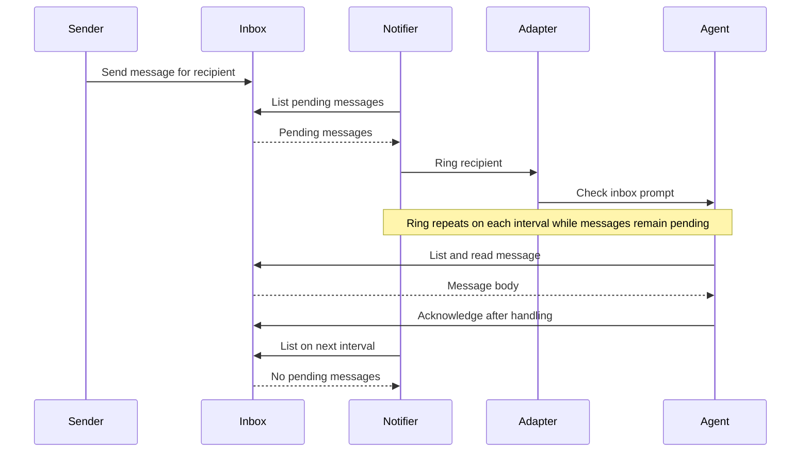

# Tincan and Concierge

> [!NOTE]
> Herdr is currently the only terminal adapter supported by `tincan-notify`.
> `concierge-control` and `concierge-supervise` use Herdr directly.

Tincan provides small Go programs for agent messaging. Concierge provides
local task and worker supervision. Each program can run on its own. The
programs share reusable packages under `pkg/` while the two command sets live
in this repository.

| Program | Responsibility |
| --- | --- |
| `tincan-inbox` | Store, list, read, and acknowledge messages for a recipient. |
| `tincan-task-reply` | Send and check worker replies against a task generation. |
| `tincan-task-receive` | Read and acknowledge assignments for the current worker generation. |
| `concierge-brief` | Show pending primary wakes, queued backlog work, local tasks, and registered workers at session start. |
| `concierge-worker` | Record and inspect local worker launch identities. |
| `concierge-backlog` | Queue, list, start, and finish tasks in the supervisor backlog. |
| `concierge-task` | Adopt a live local worker, cancel an incomplete adoption, or list task records. |
| `tincan-notify` | Ring an agent while its inbox has pending messages. |
| `concierge-control` | Inspect, start, or interrupt an agent. |
| `concierge-supervise` | Check an agent and restart it after confirmed absence. |

The inbox is the durable handoff. A sender stores a message with
`tincan-inbox send`. The notifier rings the recipient at intervals until the
recipient reads and acknowledges the message. A ring is a prompt to check the
inbox; it is not a delivery receipt. A sender can supply a stable `--key` to
retry a send without creating another message. Reusing a key with a different
body returns an error.



The inbox works independently of a terminal adapter. The notifier selects an
adapter with `--adapter` and an agent name or pane ID with `--target`. The
`--session` value selects the Herdr session that owns the target; it can also
come from `HERDR_SESSION`. The notifier refuses to start without a valid
session. The `--recipient` value selects the mailbox. The notifier, control, and supervisor
programs accept a `--herdr` path if the Herdr command is not on `PATH`. The supervisor
uses `go-capataz` to run the health monitor and tolerate repeated restarts and
monitor failures. Herdr's `unknown` agent status does not trigger
a restart. The supervisor starts an agent only
when Herdr reports that the agent is absent and the pane is ready. Repeat
`--agent-arg` to pass agent launch arguments through Herdr's `--` separator.
Configure the agent's resume identity, model, and effort there when needed. A
restart alone launches an agent; it does not restore its prior work. The
durable inbox keeps pending messages available after a restart.

Concierge control does not yet exit or relaunch agents. Safe exit requires proof
that the agent input line is empty. Herdr 0.9.3 does not expose that state.

## Build and test

The flake pins Nixpkgs, Herdr, and the Go module dependencies. The
development shell provides Go 1.25, golines, and Herdr.
Each command has its own package output, so an inbox installation does not bring
Herdr into its runtime path.
The notifier, task sender, task manager, control, and supervisor packages include
the pinned Herdr command.

```sh
nix develop
nix fmt
go test ./...
nix flake check --no-write-lock-file
nix build .#tincan
nix build .#concierge
nix build .#tincan-inbox
nix build .#tincan-task-reply
nix build .#tincan-task-receive
nix build .#concierge-brief
nix build .#concierge-worker
nix build .#concierge-backlog
nix build .#concierge-task
nix build .#tincan-notify
nix build .#concierge-control
nix build .#concierge-supervise
```

Each individual command build places one command in `result/bin/`. To install one command
in a user profile, use `nix profile install .#tincan-inbox` (or another output
name). `.#tincan` provides the message commands. `.#concierge` provides the
six supervisor commands.
`nix fmt` formats Go files with golines at 100 columns. The flake check
verifies formatting, builds every separate output, and runs the complete Go
test suite once in a dedicated check.

## Example

Use one state directory for the sender, recipient, and notifier:

```sh
tincan-inbox --root ./tincan-state send worker-1 --key task-42 --body 'Please check the task.'
tincan-notify --root ./tincan-state --recipient worker-1 --target w1:p2 --session work --adapter herdr
```

The notifier keeps running until it receives an interrupt or termination signal.

At session start, show pending primary wakes, queued backlog work, local tasks, and registered workers. With no
flags, the brief reads supervisor state from `.concierge` and messages from
`.tincan` in the current directory. `--root` or `CONCIERGE_HOME` selects the
supervisor root. `--message-root` or `TINCAN_HOME` selects the message root.
The brief limits each list to ten rows by default and reports the full count.
Use `--limit` for up to 100 rows. Queued rows come from `backlog.md` under the
supervisor root. Use `concierge-backlog list` to read all queued rows. The brief
reads state without creating it.

```sh
concierge-brief --root /absolute/concierge-state --message-root /absolute/tincan-state
concierge-task --root /absolute/concierge-state list
```

Queue a task in the root backlog with pinned `tasks-axi` 0.2.6 installed on
`PATH`. The command creates `backlog.md` under the selected supervisor root
when the file is absent. A repeated task ID returns an error and leaves the
existing task unchanged. After adopting a live local worker with `concierge-task`,
start the queued backlog row. The start command requires matching task metadata
and a current worker record. It rejects blocked or held work and can be retried
after an interrupted transition. The start command requires version 0.2.6
because it uses that version's backlog lock protocol. The `finish` command
completes a task after its recorded worker pane closes.

```sh
concierge-backlog --root /absolute/concierge-state add task-1 'Fix startup' --kind task --repo exmachina
concierge-backlog --root /absolute/concierge-state list
concierge-backlog --root /absolute/concierge-state show task-1 --full
concierge-backlog --root /absolute/concierge-state start task-1
```

Use `show ID --full` to read the complete title and body for a listed task.

The worker reads the pending message and acknowledges it after handling it:

```sh
tincan-inbox --root ./tincan-state list task-1
tincan-inbox --root ./tincan-state read task-1 MESSAGE_ID
tincan-inbox --root ./tincan-state ack task-1 MESSAGE_ID
```

For a supervised task, `tincan-task-send` stores a JSON assignment with the task
ID, state path, spawn generation, and body. The worker uses `tincan-task-receive`
to read and acknowledge the assignment against its launch generation. A stale
assignment reports `status: stale` without its body. The worker sends a reply through
`tincan-task-reply send` with the generation from the assignment. The reply
command checks the current task binding before it stores a
structured message for `firstmate`. Pass `--assignment-id` to acknowledge the
assignment after the reply is durable. Reusing the reply key after a crash
returns the same reply and completes the acknowledgement. A changed reply key
for the same assignment is rejected. An assignment retry with the same key and
body returns the same message ID within one worker generation. A new generation
gets a new assignment ID. The primary uses `check` before acting on the reply. It
reports `stale` without the reply body if the task has ended or its worker
generation changed. A separate `tincan-notify` process can ring the primary
while its inbox has pending messages.

```sh
tincan-task-receive --task-root /absolute/concierge-state --message-root /absolute/tincan-state read task-1 MESSAGE_ID --generation GEN
tincan-task-receive --task-root /absolute/concierge-state --message-root /absolute/tincan-state ack task-1 MESSAGE_ID --generation GEN
tincan-task-reply --task-root /absolute/concierge-state --message-root /absolute/tincan-state send task-1 --generation GEN --key answer-1 --assignment-id MESSAGE_ID --body-file reply.txt
tincan-inbox --root /absolute/tincan-state list firstmate
tincan-task-reply --task-root /absolute/concierge-state --message-root /absolute/tincan-state check MESSAGE_ID
tincan-inbox --root /absolute/tincan-state ack firstmate MESSAGE_ID
```

Herdr agent control and supervision use a live agent name or pane ID:

```sh
concierge-control status worker-1
concierge-control interrupt worker-1
concierge-supervise --pane PANE_ID --name worker-1 --kind codex
```

The supervisor runs until it receives an interrupt or termination signal.
Its default health interval is five seconds. Use `--interval`,
`--restart-tolerance`, and `--restart-window` to adjust the check and failure
policy. A tolerance of two permits two failures; the third stops
supervision. The supervisor does not create panes.


The worker registry records the launch details for an existing local task. It
copies the pane, project, worktree, harness, and spawn generation from the task
metadata. Supply the Herdr name and the exact agent launch arguments used for
resumption. Repeated registration with identical details succeeds; changed
details require an explicit future transition and produce a conflict now.

```sh
concierge-worker --root /absolute/concierge-state register task-1 --name worker-1 --agent-arg resume --agent-arg THREAD_ID
concierge-worker --root /absolute/concierge-state list
concierge-worker --root /absolute/concierge-state show task-1
```

Run task-bound supervision after registration:

```sh
concierge-supervise --root /absolute/concierge-state --message-root /absolute/tincan-state --task task-1
```

Task mode holds one controller lease per task. It watches the task inbox,
prompts the registered pane when a message arrives, and retries prompts while
messages remain pending. Restarting the supervisor scans pending messages.

Task mode checks the current task metadata, the registered worker, the named
Herdr session, and the pane's live foreground directory before restart. It
stores a generation-bound bootstrap message before it records the new spawn
generation and launches the replacement. It then prompts the worker to read
its inbox. A pending generation is recovered after an interrupted transition.
`concierge-worker show`
reports that pending value until recovery completes. The manual pane flags
remain available for a worker without task metadata.

Herdr can retain an agent registration after the process exits. Task mode
refuses that pane without changing its spawn generation. The pinned Herdr
release command does not clear built-in agent registrations, so stale-pane
recovery needs a server-side Herdr operation.
