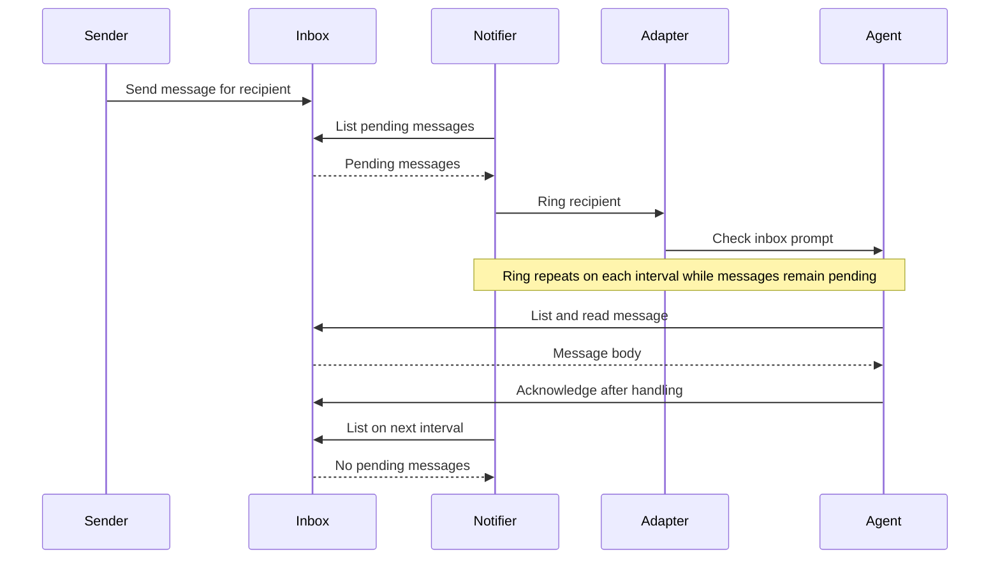

# Tincan

> [!NOTE]
> Herdr is currently the only terminal adapter supported by `tincan-notify`.
> `tincan-control` and `tincan-supervise` use Herdr directly.
> The optional Firstmate compatibility commands support local Herdr tasks only.

Tincan is inspired by Firstmate's communication scripts. It provides small Go
programs for agent messaging and control. Each program can run on its own.
The programs share reusable packages under `pkg/`.

| Program | Responsibility |
| --- | --- |
| `tincan-inbox` | Store, list, read, and acknowledge messages for a recipient. |
| `tincan-crew` | Record and inspect local worker launch identities. |
| `tincan-notify` | Ring an agent while its inbox has pending messages. |
| `tincan-control` | Inspect, start, or interrupt an agent. |
| `tincan-supervise` | Check an agent and restart it after confirmed absence. |

The inbox is the durable handoff. A sender stores a message with
`tincan-inbox send`. The notifier rings the recipient at intervals until the
recipient reads and acknowledges the message. A ring is a prompt to check the
inbox; it is not a delivery receipt. A sender can supply a stable `--key` to
retry a send without creating another message. Reusing a key with a different
body returns an error.



The inbox works independently of a terminal adapter. The notifier selects an
adapter with `--adapter` and an agent name or pane ID with `--target`. The
`--session` value selects the Herdr session that owns the target; it can also
come from `HERDR_SESSION`. The notifier refuses to start without a valid
session. The `--recipient` value selects the mailbox. The notifier, control, and supervisor
programs accept a `--herdr` path if the Herdr command is not on `PATH`. The supervisor
uses `go-capataz` to run the health monitor and tolerate repeated restarts and
monitor failures. Herdr's `unknown` agent status does not trigger
a restart. The supervisor starts an agent only
when Herdr reports that the agent is absent and the pane is ready. Repeat
`--agent-arg` to pass agent launch arguments through Herdr's `--` separator.
Configure the agent's resume identity, model, and effort there when needed. A
restart alone launches an agent; it does not restore its prior work. The
durable inbox keeps pending messages available after a restart.

Tincan control does not yet exit or relaunch agents. Safe exit requires proof
that the agent input line is empty. Herdr 0.9.3 does not expose that state.

## Build and test

The flake pins Nixpkgs, Herdr, and the Go module dependencies. The
development shell provides Go 1.25, golines, and Herdr.
Each command has its own package output, so an inbox installation does not bring
Herdr into its runtime path.
The notifier, control, supervisor, and Firstmate compatibility packages include
the pinned Herdr command.

```sh
nix develop
nix fmt
go test ./...
nix flake check --no-write-lock-file
nix build .#tincan-inbox
nix build .#tincan-crew
nix build .#tincan-notify
nix build .#tincan-control
nix build .#tincan-supervise
nix build .#tincan-firstmate-send
nix build .#tincan-firstmate-check
nix build .#tincan-firstmate-watch
nix build .#tincan-firstmate-show
```

Each build places exactly one command in `result/bin/`. To install one command
in a user profile, use `nix profile install .#tincan-inbox` (or another output
name). `nix build` and `nix profile install .#tincan` provide all nine commands.
`nix fmt` formats Go files with golines at 100 columns. The flake check
verifies that formatting, builds every separate output, checks the Firstmate
executables, and runs the complete Go test suite once in a dedicated check.

## Example

Use one state directory for the sender, recipient, and notifier:

```sh
tincan-inbox --root ./tincan-state send worker-1 --key task-42 --body 'Please check the task.'
tincan-notify --root ./tincan-state --recipient worker-1 --target w1:p2 --session work --adapter herdr
```

The second command keeps running. The worker reads the pending message and
acknowledges it after handling it:

```sh
tincan-inbox --root ./tincan-state list worker-1
tincan-inbox --root ./tincan-state read worker-1 MESSAGE_ID
tincan-inbox --root ./tincan-state ack worker-1 MESSAGE_ID
```

Herdr agent control and supervision use a live agent name or pane ID:

```sh
tincan-control status worker-1
tincan-control interrupt worker-1
tincan-supervise --pane PANE_ID --name worker-1 --kind codex
```

The supervisor runs until it receives an interrupt or termination signal.
Its default health interval is five seconds. Use `--interval`,
`--restart-tolerance`, and `--restart-window` to adjust the check and failure
policy. A tolerance of two permits two failures; the third stops
supervision. The supervisor does not create panes.

## Optional Firstmate task compatibility

The crew registry records the launch details for an existing local task. It
copies the pane, project, worktree, harness, and spawn generation from the task
metadata. Supply the Herdr name and the exact agent launch arguments used for
resumption. Repeated registration with identical details succeeds; changed
details require an explicit future transition and produce a conflict now.

```sh
tincan-crew --root /absolute/tincan-state register task-1 --name worker-1 --agent-arg resume --agent-arg THREAD_ID
tincan-crew --root /absolute/tincan-state list
tincan-crew --root /absolute/tincan-state show task-1
```

Run task-bound supervision after registration:

```sh
tincan-supervise --root /absolute/tincan-state --task task-1
```

Task mode checks the current task metadata, the registered worker, the named
Herdr session, and the pane's live foreground directory before restart. It
records a new spawn generation before launching the replacement. A pending
generation is recovered after an interrupted transition. `tincan-crew show`
reports that pending value until recovery completes. The manual pane flags
remain available for a worker without task metadata.

Herdr can retain an agent registration after the process exits. Task mode
refuses that pane without changing its spawn generation. The pinned Herdr
release command does not clear built-in agent registrations, so stale-pane
recovery needs a server-side Herdr operation.

`tincan-firstmate-send`, `tincan-firstmate-check`,
`tincan-firstmate-watch`, and `tincan-firstmate-show` use Firstmate's ordinary
`.msg` task inbox format. This format is separate from the JSON mailbox used by
`tincan-inbox`. The compatibility commands require an explicit absolute
`--state` directory. Send, check, and show require a task ID bound to a local
task metadata file. Watch scans the metadata files in the state directory.

```sh
tincan-firstmate-send --state /absolute/firstmate/state task-1 --body 'Please check the task.'
tincan-firstmate-check --state /absolute/firstmate/state task-1
tincan-firstmate-check --state /absolute/firstmate/state --wake-root /absolute/tincan-state task-1
tincan-firstmate-watch --state /absolute/firstmate/state --wake-root /absolute/tincan-state
tincan-firstmate-show --state /absolute/firstmate/state task-1 001.msg
```

The send command commits a numbered `.msg` record before it tries a terminal
doorbell. A committed record returns exit 0 even when the doorbell is deferred,
fails, or finds the endpoint unavailable. The recipient reads the record and
acknowledges it by moving it into its inbox's `handled/` directory. The send
command returns exit 2 for usage errors, exit 6 for an opposing live supervision
lease, and exit 1 for an operational error before the record commits.

The check command runs once. It examines the oldest ordinary pending record.
After the default 90-second grace period, it waits for a busy agent or tries a
doorbell. Each sent, deferred, or failed ring consumes one watcher attempt.
The default budget is three attempts. A missing or dead endpoint, or an idle
agent with a spent budget, produces an escalation outcome. Set
`--grace-seconds` and `--max-attempts` to change the policy. Their environment
defaults are `FM_TASK_INBOX_GRACE_SECS` and `FM_TASK_INBOX_RING_MAX`. The check
command returns exit 0 for quiet, wait, ring, and escalation outcomes; usage
errors return exit 2 and operational errors return exit 1.

A fresh doorbell is deferred. The conservative Herdr ring can press Enter only
when it sees the exact doorbell on a single visible composer row. Full
Firstmate composer and terminal behavior remains unsupported. These commands
do not replace `fm-send` or `fm-watch`. They do not support remote or secondmate
delivery, correlations, `--resolve-key`, fire-and-forget delivery, typed
commands, or other backends. The resident watcher scans local task metadata and
checks each task on a five-second interval. `--once` runs one sweep for a
scheduled check or a diagnostic. It continues checking other tasks when one
task fails. The one-shot check and resident watcher share one Tincan retry
writer lock. A second Tincan writer exits without changing retry state.

The Tincan lock does not coordinate with Firstmate's Bash watcher. Stop the
Bash watcher before starting the Tincan watcher against the same state directory.

The show command reads validated current task metadata and one numbered message
record without changing retry state. It reports whether the record is pending,
handled, or missing. The default body preview is 800 characters; use `--full`
to read the complete message. Compare the current spawn generation and record
state with a durable wake before acting on it.

With `--wake-root`, the check command publishes an escalation to Tincan's JSON
inbox under recipient `firstmate`. The wake identifies the absolute Firstmate
state directory, task, pending record, and spawn generation. Repeated
publication for that identity returns the same message. The command writes
`.escalated` only after the wake is durable. Without `--wake-root`, it reports
escalation without writing that marker. Read and acknowledge a wake with
`tincan-inbox --root /absolute/tincan-state list firstmate`, then `read` and
`ack` with the returned message ID. An operator can inspect these pending
wakes now; a resident supervisor that consumes them is still needed. A wake
requires a current-state check before action. The marker suppresses another
wake for the same pending record, even if the worker restarts. The spawn
generation scopes wake identity if the record is rearmed. Keep one retry-state
writer when moving from Firstmate's watcher to this command.
