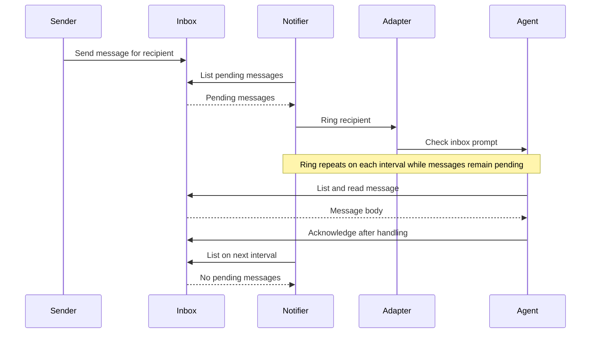

# Tincan

> [!NOTE]
> Herdr is currently the only terminal adapter supported by `tincan-notify`.
> `tincan-control` and `tincan-supervise` use Herdr directly.

Tincan is inspired by Firstmate's communication scripts. It provides small Go
programs for agent messaging and control. Each program can run on its own.
The programs share reusable packages under `pkg/`.

| Program | Responsibility |
| --- | --- |
| `tincan-inbox` | Store, list, read, and acknowledge messages for a recipient. |
| `tincan-notify` | Ring an agent while its inbox has pending messages. |
| `tincan-control` | Inspect, start, or interrupt an agent. |
| `tincan-supervise` | Check an agent and restart it after confirmed absence. |

The inbox is the durable handoff. A sender stores a message with
`tincan-inbox send`. The notifier rings the recipient at intervals until the
recipient reads and acknowledges the message. A ring is a prompt to check the
inbox; it is not a delivery receipt. A sender can supply a stable `--key` to
retry a send without creating another message. Reusing a key with a different
body returns an error.



The inbox works independently of a terminal adapter. The notifier selects an
adapter with `--adapter` and an agent name or pane ID with `--target`. The
`--recipient` value selects the mailbox. The notifier, control, and supervisor
programs accept a `--herdr` path if the Herdr command is not on `PATH`. The supervisor
uses `go-capataz` to run the health monitor and tolerate repeated restarts and
monitor failures. Herdr's `unknown` agent status does not trigger
a restart. The supervisor starts an agent only
when Herdr reports that the agent is absent and the pane is ready. Repeat
`--agent-arg` to pass agent launch arguments through Herdr's `--` separator.
Configure the agent's resume identity, model, and effort there when needed. A
restart alone launches an agent; it does not restore its prior work. The
durable inbox keeps pending messages available after a restart.

Tincan control does not yet exit or relaunch agents. Safe exit requires proof
that the agent input line is empty. Herdr 0.9.3 does not expose that state.

## Build and test

The flake pins Nixpkgs, Herdr, and the Go module dependencies. The
development shell provides Go 1.25, golines, and Herdr.
Each command has its own package output, so an inbox installation does not bring
Herdr into its runtime path.
The notifier, control, and supervisor packages include the pinned Herdr command.

```sh
nix develop
nix fmt
go test ./...
nix flake check --no-write-lock-file
nix build .#tincan-inbox
nix build .#tincan-notify
nix build .#tincan-control
nix build .#tincan-supervise
```

Each build places exactly one command in `result/bin/`. To install one command
in a user profile, use `nix profile install .#tincan-inbox` (or another output
name). `nix build` and `nix profile install .#tincan` provide all four commands.
`nix fmt` formats Go files with golines at 100 columns. The flake check
verifies that formatting, builds every separate output, and runs the complete
Go test suite once in a dedicated check.

## Example

Use one state directory for the sender, recipient, and notifier:

```sh
tincan-inbox --root ./tincan-state send worker-1 --key task-42 --body 'Please check the task.'
tincan-notify --root ./tincan-state --recipient worker-1 --target w1:p2 --adapter herdr
```

The second command keeps running. The worker reads the pending message and
acknowledges it after handling it:

```sh
tincan-inbox --root ./tincan-state list worker-1
tincan-inbox --root ./tincan-state read worker-1 MESSAGE_ID
tincan-inbox --root ./tincan-state ack worker-1 MESSAGE_ID
```

Herdr agent control and supervision use a live agent name or pane ID:

```sh
tincan-control status worker-1
tincan-control interrupt worker-1
tincan-supervise --pane PANE_ID --name worker-1 --kind codex
```

The supervisor runs until it receives an interrupt or termination signal.
Its default health interval is five seconds. Use `--interval`,
`--restart-tolerance`, and `--restart-window` to adjust the check and failure
policy. A tolerance of two permits two failures; the third stops
supervision. The supervisor does not create panes.
